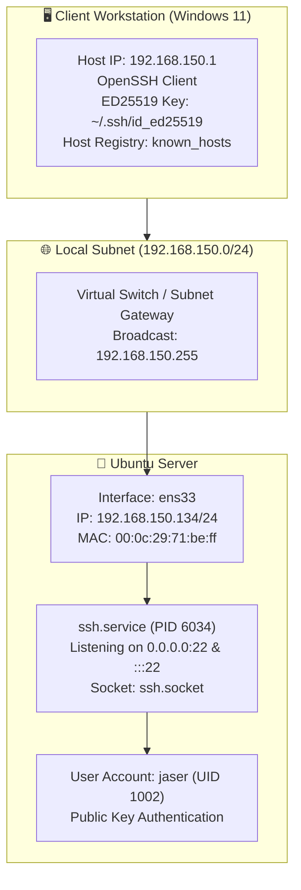

# Ubuntu Server Deployment & Systems Administration Portfolio
### Hands-on Ubuntu Server Deployment, Administration & Remote Management

[](https://ubuntu.com/download/server)
[](#)
[](#-lab-modules-index)
[](https://github.com/JaserHalabi)

> A practical portfolio documenting hands-on systems administration, user management, and secure remote access on **Ubuntu Server**.

---

## 📖 Overview

This repository documents hands-on configurations and lab exercises performed on **Ubuntu Server**.

Each lab includes step-by-step procedures, terminal commands, outputs, network architecture, and visual evidence captured during execution.

---

## 🏛️ Infrastructure Architecture



---

## 📑 Lab Modules Index

| # | Lab Module | Key Topics & Competencies | Status | Documentation |
|:---:|---|---|:---:|:---:|
| **01** | **Initial Setup, User Management & Secure SSH Access** | User creation (`adduser`), service management (`systemctl`), network discovery (`ip addr`), host fingerprint verification, and ED25519 key authentication (`ssh-keygen`, `ssh-copy-id`) | Complete | [View Lab 01](./labs/01-ssh-configuration-and-remote-access/) |

---

## 🚀 Lab 01 Summary: User Provisioning & Secure SSH Remote Access

### Implementation Steps

1. **User Account Provisioning:**
   - Created dedicated user account `jaser` with primary group `jaser` and home directory `/home/jaser`.
2. **OpenSSH Service Management:**
   - Checked initial status (`inactive (dead)`), started the `ssh` service, and verified active state with `sshd` listening on port `22`.
3. **Network Discovery:**
   - Queried interface addressing using `ip addr` to identify server IP `192.168.150.134/24` on interface `ens33`.
4. **Initial Remote Access & Host Verification:**
   - Initiated remote connection `ssh jaser@192.168.150.134`, verified and accepted ED25519 fingerprint into `known_hosts`, authenticated, and verified identity with `whoami`.
5. **ED25519 Cryptographic Key Generation:**
   - Generated modern ED25519 public/private key pair on the client machine via `ssh-keygen -t ed25519`.
6. **Public Key Deployment:**
   - Transferred public key to the remote server using `ssh-copy-id jaser@192.168.150.134`.
7. **Session Verification & Login Auditing:**
   - Verified successful session establishment and inspected login audit record (`Last login: ... from 192.168.150.1`).

### Commands Reference

```bash
# 1. Provision user account
sudo adduser jaser

# 2. Check and start OpenSSH service
sudo systemctl status ssh
sudo systemctl start ssh
sudo systemctl status ssh

# 3. Discover IP address
ip addr

# 4. Connect via SSH from client
ssh jaser@192.168.150.134
whoami

# 5. Generate ED25519 SSH key pair (Client)
ssh-keygen -t ed25519

# 6. Deploy public key to server
ssh-copy-id jaser@192.168.150.134

# 7. Re-connect and verify session
ssh jaser@192.168.150.134
```

---

## 👤 Author Information

- **Analyst & Administrator:** **Jaser Halabi**
- **GitHub Profile:** [@JaserHalabi](https://github.com/JaserHalabi)
