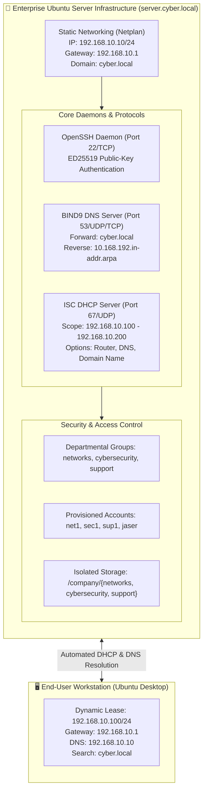

# Ubuntu Server Deployment & Systems Administration Portfolio
### Hands-on Ubuntu Server Deployment, Administration & Remote Management

> A practical portfolio documenting hands-on systems administration, role-based user management, enterprise static networking, authoritative DNS, and automated DHCP provisioning on **Ubuntu Server**.

---

## 📖 Overview

This repository documents hands-on configurations, network service deployments, and administration labs performed on **Ubuntu Server**.

Each lab includes step-by-step procedures, terminal commands, configuration files, service status outputs, network architecture, and visual evidence captured during live execution.

---

## 🏛️ Infrastructure Architecture

---

## 📑 Lab Modules Index

| # | Lab Module | Key Topics & Competencies | Status | Documentation |
|:---:|---|---|:---:|:---:|
| **01** | **Initial Setup, User Management & Secure SSH Access** | User creation (`adduser`), service management (`systemctl`), network discovery (`ip addr`), host fingerprint verification, and ED25519 key authentication (`ssh-keygen`, `ssh-copy-id`) | Complete | [View Lab 01](./labs/01-ssh-configuration-and-remote-access/) |
| **02** | **Departmental Access Control, Netplan, BIND9 DNS & ISC DHCP Server** | Group and user RBAC (`groupadd`, `usermod`, `id`), directory isolation (`/company/`), Netplan static IP (`192.168.10.10/24`), BIND9 forward/reverse DNS (`cyber.local`), ISC DHCP server pool (`192.168.10.100-200`), and live client lease verification | Complete | [View Lab 02](./labs/02-dns-dhcp-and-access-control/) |

---

## 🚀 Lab Summaries

### Lab 01: User Provisioning & Secure SSH Remote Access
- **Objectives:** Deploy dedicated administrative credentials, initialize systemd unit files, verify host fingerprints via TOFU, and enforce Elliptic Curve ED25519 public-key authentication.
- **Key Commands:** `adduser`, `systemctl start ssh`, `ssh-keygen -t ed25519`, `ssh-copy-id`.
- **Full Report:** [View Lab 01 Documentation](./labs/01-ssh-configuration-and-remote-access/)

---

### Lab 02: Departmental Access Control, Netplan, BIND9 DNS & ISC DHCP Server
- **Objectives:** Implement role-based access control with isolated departmental directories, transition from DHCP to deterministic Netplan static IPv4 networking, deploy authoritative BIND9 DNS with forward and reverse zones, and automate workstation configuration via ISC DHCP Server.
- **Architecture Highlights:**
  - **Access Control:** Groups `networks`, `cybersecurity`, `support` with users `net1`, `sec1`, `sup1` and segregated directories under `/company/`.
  - **Netplan Configuration:** Static assignment `192.168.10.10/24`, gateway `192.168.10.1`, domain search `cyber.local`, localized hostname `server`.
  - **BIND9 DNS:** Forward zone `cyber.local` and reverse zone `10.168.192.in-addr.arpa`, validated via `dig`.
  - **ISC DHCP Server:** Subnet scope `192.168.10.0/24` with pool `192.168.10.100` – `192.168.10.200`, distributing default route, DNS, and search domain.
  - **Workstation Verification:** Ubuntu Desktop dynamically leases `192.168.10.100/24` with verified name resolution and default routing.
- **Full Report:** [View Lab 02 Documentation](./labs/02-dns-dhcp-and-access-control/)

---

## 👤 Author Information

- **Analyst & Administrator:** **Jaser Halabi**
- **GitHub Profile:** [@JaserHalabi](https://github.com/JaserHalabi)
