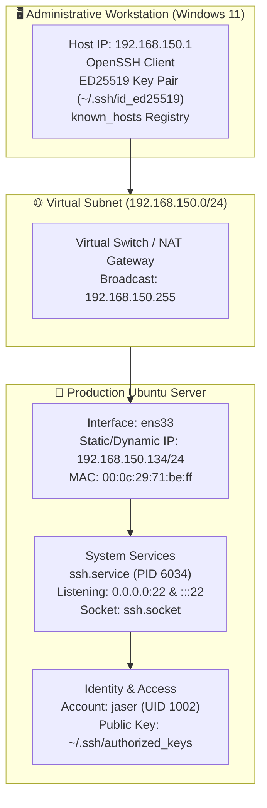

# Ubuntu Server Deployment & Systems Administration Portfolio
### Enterprise Linux Infrastructure, Service Automation & Security Hardening

[](https://ubuntu.com/download/server)
[](#)
[](#-overview)
[](#-lab-modules-index)
[](https://github.com/JaserHalabi)

> A practical, hands-on portfolio documenting Linux systems administration, enterprise server deployment, network service orchestration, and security hardening on **Ubuntu Server**.

---

## 📖 Overview

This repository contains end-to-end documentation, technical write-ups, and verified configurations executed across **Ubuntu Server** instances in a virtualized enterprise homelab environment.

Each module focuses on practical system administration tasks—from initial operating system provisioning, network discovery, and remote access security, to service daemon orchestration and access control. Every lab write-up includes step-by-step terminal execution, architecture diagrams, verification checks, and raw visual evidence.

---

## 🏛️ Infrastructure Architecture



---

## 📑 Lab Modules Index

Click on a module below to view the dedicated write-up, procedures, commands, and screenshots:

| # | Lab Module | Key Topics & Competencies | Status | Documentation |
|:---:|---|---|:---:|:---:|
| **01** | **Initial Setup, User Management & Secure SSH Access** | User creation (`adduser`), systemd service control (`systemctl`), network addressing (`ip addr`), host fingerprint validation, and ED25519 public-key authentication (`ssh-keygen`, `ssh-copy-id`) | Complete | [View Lab 01](./labs/01-ssh-configuration-and-remote-access/) |
| **02** | **Static Network Configuration & Netplan Administration** | YAML-based Netplan configuration, interface bonding, DNS nameservers, gateway routing, and interface state diagnostics | Planned | *Upcoming* |
| **03** | **Linux Security Hardening & UFW Firewall Deployment** | Uncomplicated Firewall (UFW) rulesets, SSH daemon hardening (`sshd_config`), Fail2ban brute-force protection, and audit logging | Planned | *Upcoming* |
| **04** | **Storage Administration & Logical Volume Management (LVM)** | Physical volumes (PV), volume groups (VG), logical volumes (LV), filesystem expansion, and automated mounting via `/etc/fstab` | Planned | *Upcoming* |
| **05** | **Containerized Workloads & Enterprise Service Orchestration** | Docker CE installation, systemd container service wrappers, Nginx reverse proxying, and automated TLS certificate issuance | Planned | *Upcoming* |

---

## 🚀 Lab 01 Spotlight: Secure SSH & User Administration

### Key Implementation Milestones

1. **Least-Privilege User Provisioning:**
   - Deployed dedicated administrative user `jaser` with dedicated primary group `jaser` and secure home directory permissions.
   - Mitigated exposure of the default `root` and unmonitored baseline accounts.

2. **OpenSSH Server Daemon Control:**
   - Discovered and addressed inactive state in `ssh.service`.
   - Activated daemon listeners across both IPv4 (`0.0.0.0:22`) and IPv6 (`:::22`) under systemd socket management.

3. **Remote Trust & Fingerprint Validation:**
   - Established initial connection from Windows workstation `192.168.150.1` to target `192.168.150.134`.
   - Validated server ED25519 host key fingerprint to protect against adversary-in-the-middle (AiTM) risks.

4. **Modern Elliptic-Curve Cryptography:**
   - Generated high-performance, side-channel-resistant **ED25519** key pairs (`ssh-keygen -t ed25519`).
   - Automated public key injection to remote target via `ssh-copy-id`.

### Quick Reference Commands

```bash
# User Management
sudo adduser jaser
sudo usermod -aG sudo jaser

# OpenSSH Service Management
sudo systemctl status ssh
sudo systemctl start ssh
sudo systemctl enable ssh

# Network Interface & IP Discovery
ip addr show ens33
ip route show

# Client-Side Key Generation & Deployment
ssh-keygen -t ed25519
ssh-copy-id jaser@<server-ip>

# Secure Connection
ssh jaser@<server-ip>
```

---

## 🛡️ Systems Hardening Reference

Production environments require defense-in-depth across the remote access surface:

- **Disable Root SSH Access:** Set `PermitRootLogin no` in `/etc/ssh/sshd_config`.
- **Enforce Cryptographic Authentication:** Disable password fallbacks using `PasswordAuthentication no`.
- **Restrict Authorized Users:** Declare explicit access with `AllowUsers <username>`.
- **Limit Authentication Surface:** Restrict maximum authentication attempts (`MaxAuthTries 3`) and configure aggressive session timeouts.
- **Firewall Filtering:** Confine port 22 access strictly to trusted management subnets via `ufw allow from <management-cidr> to any port 22 proto tcp`.

---

## 👤 Author Information

- **Analyst & Administrator:** **Jaser Halabi**
- **GitHub Profile:** [@JaserHalabi](https://github.com/JaserHalabi)
- **Specialization:** Cybersecurity, Network Engineering & Systems Infrastructure
- **Related Portfolios:**
  - [windows-server-labs](https://github.com/JaserHalabi/windows-server-labs) — Enterprise Windows Server 2019 Infrastructure & AD DS Hardening
  - [soc-homelab-wazuh](https://github.com/JaserHalabi/soc-homelab-wazuh) — SOC Homelab: Wazuh SIEM Threat Detection & Active Response
  - [Network-Analysis](https://github.com/JaserHalabi/Network-Analysis) — Traffic Capture, Protocol Analysis & Packet Filtering with Wireshark & tcpdump
  - [networking-labs](https://github.com/JaserHalabi/networking-labs) — Cisco Enterprise Topologies & Routing Protocols (OSPF, EIGRP, RIP)
