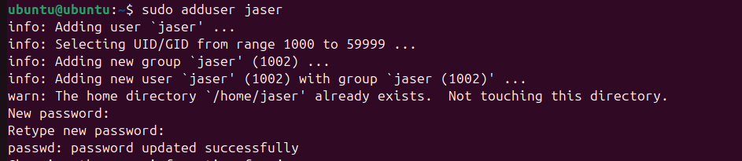
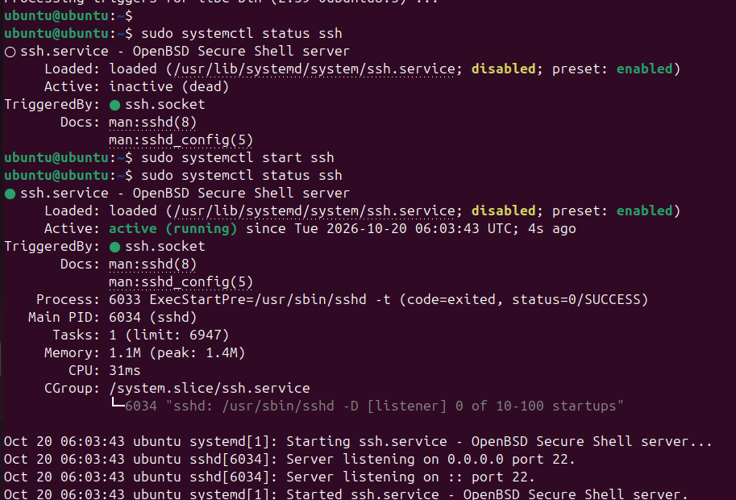
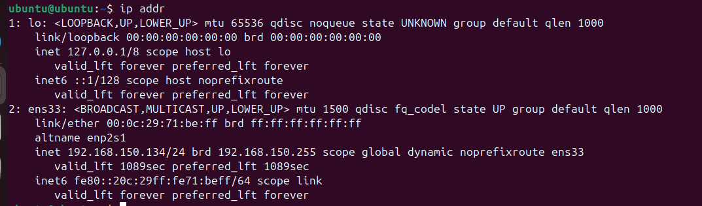
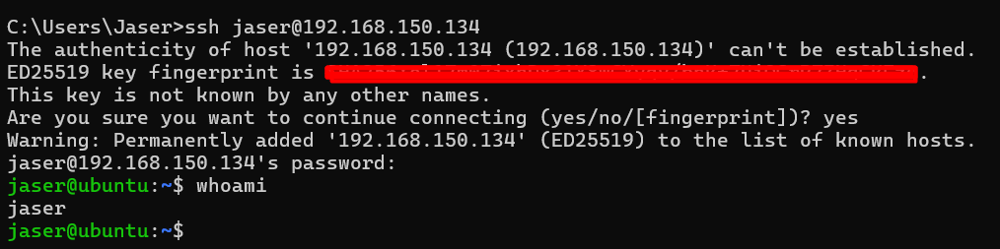
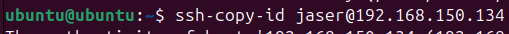
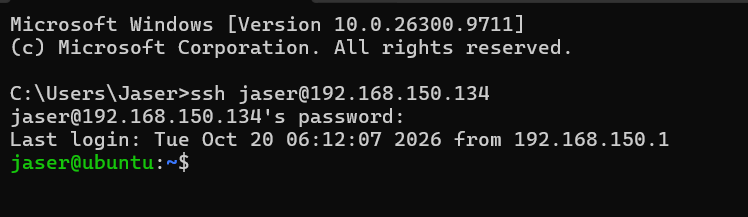

# Lab 01: Ubuntu Server Initial Configuration, User Provisioning & Secure SSH Remote Access

> **Lab Path:** `labs/01-ssh-configuration-and-remote-access`  
> **Platform:** Ubuntu Server (Linux 6.8.0 / Systemd)  
> **Target Service:** OpenSSH Daemon (`sshd`) & `ssh.socket`  
> **Client Station:** Windows 11 Enterprise (OpenSSH Client)

---

## 🎯 Lab Objectives

The objective of this lab is to configure an initial deployment of an **Ubuntu Server** instance, provision dedicated administrative user credentials adhering to the principle of least privilege, manage systemd daemon sockets for the OpenSSH server, verify network interface addressing, and establish an end-to-end encrypted remote management pipeline using modern **ED25519** public-key cryptography.

Key competencies demonstrated:
1. **Administrative User Management:** Creating a dedicated local user account (`jaser`) with group assignment and credential hardening.
2. **OpenSSH Server Lifecycle Management:** Analyzing service status, resolving inactive state, and starting `ssh.service` using `systemctl`.
3. **Network Configuration & Address Discovery:** Extracting interface attributes and IPv4 CIDR allocations using `ip addr`.
4. **Host Authenticity & Known Hosts Management:** Verifying cryptographic server fingerprints over the initial connection and populating `known_hosts`.
5. **Modern Public-Key Cryptography:** Generating Elliptic Curve ED25519 key pairs and deploying public keys using `ssh-copy-id`.
6. **Authentication Auditing:** Inspecting session login records and client provenance (`Last login` tracking).

---

## 🌐 Network Architecture & Environment Specifications

```mermaid
flowchart LR
    subgraph Client["🖥️ Management Station (Windows 11)"]
        direction TB
        C_IP["IP: 192.168.150.1"]
        C_SSH["OpenSSH Client<br/>ssh-keygen -t ed25519<br/>id_ed25519 (Private Key)"]
        C_HOSTS["known_hosts File<br/>Host Fingerprint Stored"]
    end

    subgraph Transport["🔒 Encrypted Transport Layer"]
        direction TB
        SSH_CONN["SSH Protocol v2 (Port 22/TCP)<br/>ChaCha20-Poly1305 / ED25519"]
    end

    subgraph Server["🐧 Ubuntu Server (Target Host)"]
        direction TB
        S_IP["Interface: ens33<br/>IP: 192.168.150.134/24"]
        S_USER["User: jaser (UID 1002)<br/>Group: jaser (GID 1002)"]
        S_SSHD["sshd.service (PID 6034)<br/>Listening: 0.0.0.0:22 & :::22"]
        S_AUTH["~/.ssh/authorized_keys<br/>Public Key Validation"]
    end

    Client -->|TCP Port 22| Transport
    Transport --> Server
```



### Infrastructure Inventory

| Node | Operating System | Hostname | Interface | IP Address | MAC Address | Role |
|---|---|---|---|---|---|---|
| **Server** | Ubuntu Server 24.04/22.04 LTS | `ubuntu` | `ens33` | `192.168.150.134/24` | `00:0c:29:71:be:ff` | Production Target Server |
| **Client** | Windows 11 Enterprise | Workstation | Virtual NIC | `192.168.150.1` | - | Security & Administration Station |

---

## 🛠️ Step-by-Step Implementation & Technical Walkthrough

### Step 1: Dedicated Administrative User Provisioning

Operating directly as the `root` account or default unmanaged account poses significant security risks. To implement accountability and role separation, a dedicated user account named `jaser` was provisioned.

```bash
sudo adduser jaser
```



#### Execution Analysis:
- The `adduser` utility dynamically allocated a UID/GID within the standard system non-system user range (`1000` to `59999`), assigning `UID: 1002` and `GID: 1002`.
- A dedicated primary group `jaser` was created.
- The home directory path `/home/jaser` was associated with the user profile.
- A strong password hash was generated and committed to `/etc/shadow` via the PAM stack (`passwd: password updated successfully`).

---

### Step 2: OpenSSH Server Inspection and Service Activation

Ubuntu Server manages background daemons via `systemd`. Before attempting remote connections, the state of the OpenBSD Secure Shell server (`sshd`) was inspected:

```bash
sudo systemctl status ssh
```

Initial inspection revealed that while the unit file was loaded (`/usr/lib/systemd/system/ssh.service`), the daemon was currently in an `inactive (dead)` state.

The service was immediately started and verified:

```bash
sudo systemctl start ssh
sudo systemctl status ssh
```



#### Technical State Verification:
- **Active State:** Transitioned from `inactive (dead)` to `active (running)`.
- **Process ID:** Master daemon spawned as Main PID `6034 (sshd)`.
- **Pre-execution Check:** Executed configuration syntax validator `/usr/sbin/sshd -t` with return code `0/SUCCESS`.
- **Socket Listeners:** Confirmed socket bindings:
  - IPv4: Listening on `0.0.0.0` on port `22`.
  - IPv6: Listening on `::` on port `22`.
- **TriggeredBy:** Bound to `ssh.socket` under systemd socket activation architecture.

---

### Step 3: Network Topology & Interface Discovery

To route administrative traffic from the management workstation to the server, the active IPv4 addressing and interface parameters were surveyed using the `iproute2` suite:

```bash
ip addr
```



#### Network Configuration Breakdown:
- **Loopback (`lo`):** `127.0.0.1/8` — internal inter-process communication interface.
- **Physical/Virtual Interface (`ens33` / altname `enp2s1`):**
  - **State:** `UP` with MTU `1500` and queue discipline `fq_codel`.
  - **Hardware MAC Address:** `00:0c:29:71:be:ff`.
  - **IPv4 Address:** `192.168.150.134` with CIDR mask `/24` (`255.255.255.0`).
  - **Broadcast Address:** `192.168.150.255`.
  - **IPv6 Link-Local:** `fe80::20c:29ff:fe71:beff/64`.

---

### Step 4: Initial Remote Access & Host Key Fingerprint Validation

From the management workstation (Windows command prompt `C:\Users\Jaser`), an initial SSH connection was initiated targeting the newly created administrative account:

```cmd
ssh jaser@192.168.150.134
```



#### Cryptographic Verification & Host Trust:
1. **Trust-On-First-Use (TOFU):** Because the client had no prior record for `192.168.150.134`, SSH presented the server's **ED25519** public key fingerprint:
   ```text
   The authenticity of host '192.168.150.134 (192.168.150.134)' can't be established.
   ED25519 key fingerprint is SHA256:...
   Are you sure you want to continue connecting (yes/no/[fingerprint])? yes
   ```
2. **Known Hosts Persistence:** Confirming the connection added the cryptographic identity to `%USERPROFILE%\.ssh\known_hosts`, preventing Man-In-The-Middle (MITM) impersonation in future sessions.
3. **Session Authentication:** Upon supplying the password, the shell authenticated successfully.
4. **Privilege & Identity Check:**
   ```bash
   jaser@ubuntu:~$ whoami
   jaser
   ```

---

### Step 5: High-Security Cryptographic Key Pair Generation

To replace password-based authentication with cryptographically robust, brute-force-resilient public-key authentication, an **ED25519** (Edwards-curve Digital Signature Algorithm) key pair was generated on the management workstation:

```powershell
ssh-keygen -t ed25519
```


#### Why ED25519 over Traditional RSA?
- **Shorter Key Length:** 256-bit key length provides security equivalent to ~3072-bit RSA, resulting in faster key exchange and signature operations.
- **Side-Channel Immunity:** Designed to be immune to cache-timing attacks and branch prediction vulnerabilities.
- **Collision Resistance:** Extreme resistance to collision and signature malleability attacks.

---

### Step 6: Public Key Distribution via `ssh-copy-id`

The public key component (`id_ed25519.pub`) was provisioned to the Ubuntu target server's authorized keys list using the automated `ssh-copy-id` tool:

```bash
ssh-copy-id jaser@192.168.150.134
```



#### Operational Mechanism:
1. Connects to the remote target host over standard SSH.
2. Automatically ensures directory `/home/jaser/.ssh` exists with permissions `700` (`drwx------`).
3. Appends the client's public key string to `/home/jaser/.ssh/authorized_keys` with strict file permissions `600` (`-rw-------`).
4. Prevents duplicate key entries and ensures file ownership matches `jaser:jaser`.

---

### Step 7: Session Verification & Audit Log Tracking

With key distribution completed, a new SSH session was established from the client to verify session establishment and evaluate server-side login logs:

```cmd
ssh jaser@192.168.150.134
```



#### Session Evidence & Provenance:
```text
Microsoft Windows [Version 10.0.26300.9711]
C:\Users\Jaser>ssh jaser@192.168.150.134
Last login: Tue Oct 20 06:12:07 2026 from 192.168.150.1
jaser@ubuntu:~$
```
- **Login Auditing:** The system correctly tracked and reported the previous successful logon from workstation IP `192.168.150.1`.
- **Shell Availability:** The session successfully dropped into the bash shell (`jaser@ubuntu:~$`) ready for remote administration.

---

## 🔒 Security Hardening Recommendations

To achieve full enterprise-grade production compliance, the following additional configurations should be applied to `/etc/ssh/sshd_config` or `/etc/ssh/sshd_config.d/99-hardened.conf`:

```bash
# 1. Disable root login across the network
PermitRootLogin no

# 2. Enforce strict public-key-only authentication
PasswordAuthentication no
KbdInteractiveAuthentication no

# 3. Restrict allowed login accounts
AllowUsers jaser

# 4. Limit authentication attempts and session timeouts
MaxAuthTries 3
ClientAliveInterval 300
ClientAliveCountMax 2

# 5. Enable firewall protection using UFW
sudo ufw default deny incoming
sudo ufw default allow outgoing
sudo ufw allow 22/tcp comment 'Allow OpenSSH'
sudo ufw enable
```

---

## 📊 Verification Matrix

| Verification Check | Target / Command | Expected Result | Outcome |
|---|---|---|:---:|
| User Creation | `id jaser` | UID `1002`, GID `1002`, member of `jaser` | **PASSED** |
| SSH Daemon Status | `systemctl status ssh` | `active (running)`, PID `6034` | **PASSED** |
| Port 22 Binding | `ss -tulpn \| grep :22` | Listening on `0.0.0.0:22` & `:::22` | **PASSED** |
| IP Reachability | Ping / ARP from client | Subnet `192.168.150.0/24` routed | **PASSED** |
| Fingerprint Verification | `ssh jaser@192.168.150.134` | Fingerprint matched and saved to `known_hosts` | **PASSED** |
| Cryptographic Key Generation | `ssh-keygen -t ed25519` | Key pair generated in `~/.ssh/` | **PASSED** |
| Key Deployment | `ssh-copy-id` | Public key committed to `~/.ssh/authorized_keys` | **PASSED** |
| Session Authentication | `ssh jaser@192.168.150.134` | Authenticated session with audit trace | **PASSED** |

---

_Documented by **[Jaser Halabi](https://github.com/JaserHalabi)**_
