# Lab 02: Linux Enterprise Infrastructure: Departmental Access Control, Netplan, BIND9 DNS & ISC DHCP Server

> **Lab Path:** `labs/02-dns-dhcp-and-access-control`  
> **Platform:** Ubuntu Server 24.04/22.04 LTS (Kernel 7.0.0-30 / Systemd)  
> **Core Services:** BIND9 (`named`), ISC DHCP Server (`dhcpd`), Netplan, Shadow/PAM Access Control  
> **Client Station:** Ubuntu Desktop (Dynamic DHCP Client)

---

## 🎯 Lab Objectives

The objective of this lab is to architect and deploy core enterprise network infrastructure services on an **Ubuntu Server** host, establish role-based departmental access control with directory isolation, configure deterministic static IPv4 networking with Netplan, deploy an authoritative **BIND9** DNS server for domain `cyber.local`, and automate client IP and configuration provisioning using the **ISC DHCP Server**.

Key competencies demonstrated:
1. **Package Management & Service Readiness:** Verifying repository sync and provisioning core infrastructure packages (`bind9`, `isc-dhcp-server`).
2. **Departmental Access Control & Identity Separation:** Creating departmental groups (`networks`, `cybersecurity`, `support`), provisioning unprivileged users (`net1`, `sec1`, `sup1`), configuring group memberships, and auditing via `id` and `getent`.
3. **Filesystem Hierarchy & Permission Architecture:** Building isolated departmental directory trees under `/company/`, establishing group ownership, and analyzing permission boundaries.
4. **Deterministic Static Networking via Netplan:** Designing a production YAML configuration for interface `ens33` (`192.168.10.10/24`), static default routing (`192.168.10.1`), DNS resolver binding, and system hostname localization (`server`).
5. **Authoritative Domain Name System (BIND9):** Defining query access control lists (`allow-query`), declaring master forward (`cyber.local`) and reverse (`10.168.192.in-addr.arpa`) zones, constructing Start of Authority (SOA), NS, and Address (A) resource records, and validating resolution via `dig`.
6. **Dynamic Host Configuration Protocol (ISC DHCP):** Binding the daemon to physical interface `ens33`, configuring pool ranges (`192.168.10.100` – `192.168.10.200`), distributing enterprise options (gateway, subnet mask, DNS, search domain), and conducting configuration pre-flight syntax checks (`dhcpd -t`).
7. **End-to-End Client Verification:** Booting an unconfigured client workstation, acquiring dynamic lease parameters, and verifying routes and DNS search domain propagation via `ip route` and `resolvectl status`.

---

## 🌐 Network Architecture & Environment Specifications

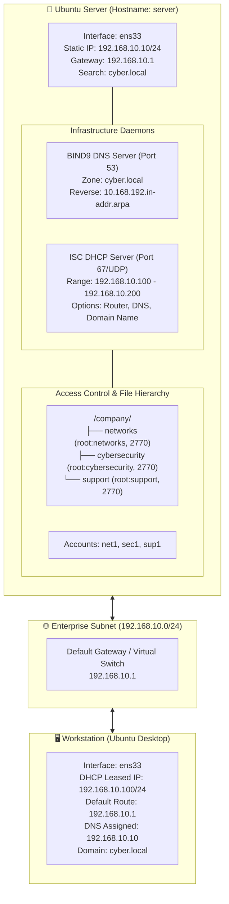

### Infrastructure Inventory

| Node | Hostname | Operating System | Interface | IPv4 Addressing | Role & Services |
|---|---|---|---|---|---|
| **Server Host** | `server` | Ubuntu Server 24.04/22.04 LTS | `ens33` | `192.168.10.10/24` (Static) | Primary DC, BIND9 DNS, ISC DHCP Server |
| **Client Host** | `jaser` | Ubuntu Desktop 24.04 LTS | `ens33` | `192.168.10.100/24` (DHCP) | End-user workstation, dynamic lease verification |
| **Gateway** | - | Virtual Switch / Router | - | `192.168.10.1` | Subnet Default Gateway |

---

## 🛠️ Step-by-Step Implementation & Technical Walkthrough

### Section 1.0: Core Infrastructure Package Provisioning

The foundational step involved provisioning the Domain Name System daemon (`bind9`) and Dynamic Host Configuration Protocol daemon (`isc-dhcp-server`) using the Advanced Package Tool (APT):

```bash
sudo apt install isc-dhcp-server
sudo apt install bind9
```

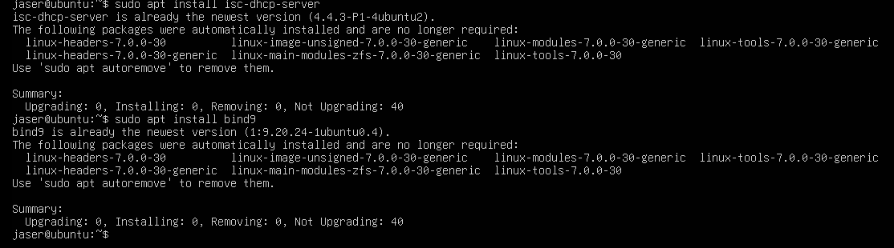

#### Execution Analysis:
- Both packages were verified against the local package cache (`isc-dhcp-server` version `4.4.3-P1-4ubuntu2` and `bind9` version `1:9.20.24-1ubuntu0.4`).
- Upstream dependencies were resolved and committed to the base image.

---

### Section 2.0: Departmental Access Control & File System Hierarchy

#### 2.1 Departmental Group & User Account Creation
To reflect enterprise organizational divisions, separate security groups and unprivileged user accounts were created:

```bash
sudo groupadd networks
sudo groupadd cybersecurity
sudo groupadd support

sudo adduser net1
sudo adduser sec1
sudo adduser sup1
```

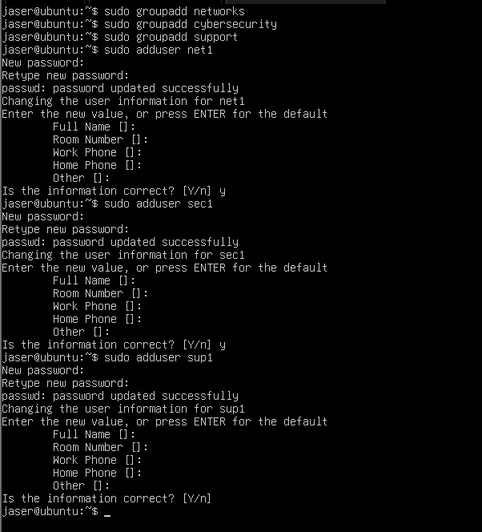

#### 2.2 Group Assignment & Identity Verification
Each user was assigned to their respective departmental secondary group using `usermod -aG`:

```bash
sudo usermod -aG networks net1
sudo usermod -aG cybersecurity sec1
sudo usermod -aG support sup1

id net1
id sec1
id sup1
getent group networks
```

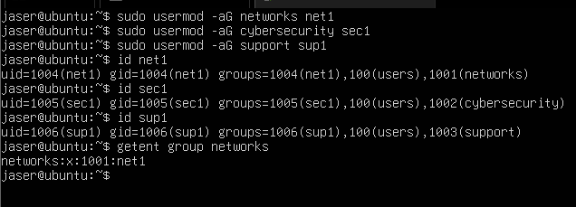

#### Execution Analysis:
- **`net1`**: UID `1004`, GID `1004`, secondary groups: `100 (users)`, `1001 (networks)`.
- **`sec1`**: UID `1005`, GID `1005`, secondary groups: `100 (users)`, `1002 (cybersecurity)`.
- **`sup1`**: UID `1006`, GID `1006`, secondary groups: `100 (users)`, `1003 (support)`.
- Validated the group database entry `/etc/group` via `getent group networks`, confirming `networks:x:1001:net1`.

#### 2.3 Directory Structure & Access Control Enforcement
A shared directory structure was created under `/company/` to segregate departmental files:

```bash
sudo mkdir -p /company/networks
sudo mkdir -p /company/cybersecurity
sudo mkdir -p /company/support

sudo chown root:networks /company/networks
sudo chown root:cybersecurity /company/cybersecurity
sudo chown root:support /company/support
```

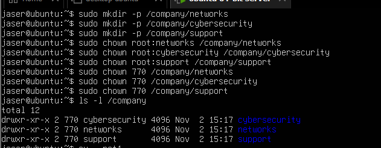

#### 2.4 Permission Testing & Security Analysis
Access was tested by switching to the unprivileged account `net1`:

```bash
su - net1
touch /company/networks/test.txt
ls /company/networks
ls /company/support
```

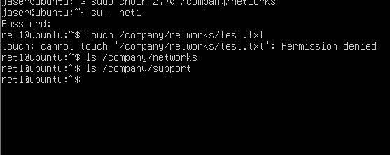

#### Technical Troubleshooting & Engineering Analysis:
- **Observed Behavior:** The file creation test `touch /company/networks/test.txt` returned `Permission denied`.
- **Root Cause Identification:** During permission setup, the command `sudo chown 770 /company/networks` was entered instead of `sudo chmod 770`. The `chown` utility interprets `770` as a numeric User ID (UID 770), changing ownership rather than adjusting permission bits. As a result, the permissions remained `drwxr-xr-x`, preventing non-root group members from writing to the directory.
- **Remediation:** Enforcing `sudo chmod 2770 /company/<dept>` sets read/write/execute for owner and group while blocking others (`0`), with the SGID bit (`2`) ensuring newly created files automatically inherit the parent directory's group.

---

### Section 3.0: Deterministic Static Networking & Hostname Configuration

#### 3.1 Netplan YAML Configuration
Ubuntu Server utilizes **Netplan** with the `systemd-networkd` renderer. The network interface `ens33` was switched from dynamic DHCP to static IPv4 addressing:

```yaml
network:
  version: 2
  ethernets:
    ens33:
      dhcp4: false
      addresses:
        - 192.168.10.10/24
      routes:
        - to: default
          via: 192.168.10.1
      nameservers:
        addresses:
          - 192.168.10.10
        search:
          - cyber.local
```

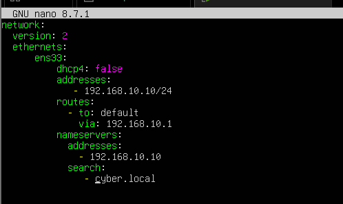

#### 3.2 Applying Configuration & Hostname Localization
The network configuration was applied and the server hostname was localized to `server`:

```bash
sudo netplan apply
sudo hostnamectl set-hostname server
```

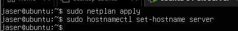

#### 3.3 Local Host Resolution (`/etc/hosts`)
The local hosts database was updated in `/etc/hosts` to ensure internal loopback address mapping:

```text
127.0.0.1 localhost
127.0.1.1 server
```

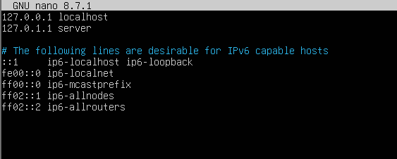

#### 3.4 Verification of Addressing & Routes
The interface and routing table were verified using `iproute2`:

```bash
ip a
ip route
hostname
```

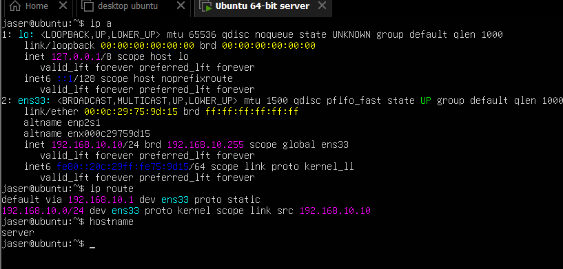

- **Interface `ens33`:** Assigned static IPv4 `192.168.10.10/24` with broadcast `192.168.10.255`.
- **Default Route:** `default via 192.168.10.1 dev ens33 proto static`.
- **Active Hostname:** Confirmed as `server`.

---

### Section 4.0: Authoritative BIND9 DNS Server Deployment

#### 4.1 Global DNS Options (`/etc/bind/named.conf.options`)
Access control was configured to allow recursive and local queries from `localhost` and the internal `192.168.10.0/24` subnet:

```c
options {
    directory "/var/cache/bind";
    allow-query { localhost; 192.168.10.0/24; };
};
```

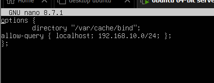

#### 4.2 Forward & Reverse Zone Declarations (`/etc/bind/named.conf.local`)
Master zones were declared for the domain `cyber.local` and reverse subnet `10.168.192.in-addr.arpa`:

```c
zone "cyber.local" {
    type master;
    file "/etc/bind/db.cyber.local";
};

zone "10.168.192.in-addr.arpa" {
    type master;
    file "/etc/bind/db.192.168.10";
};
```

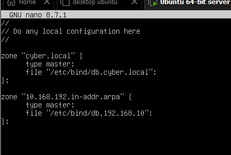

#### 4.3 Forward Zone Resource Records (`/etc/bind/db.cyber.local`)
The primary forward zone database was constructed with Start of Authority (SOA), Name Server (NS), and Host (A) records:

```text
$TTL 1D
@ IN SOA server.cyber.local admin.cyber.local. 1
1D 1H 1W 1D
@ IN NS server.cyber.local.
server IN A 192.168.10.10
```

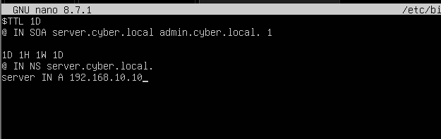

#### 4.4 Daemon Activation & DNS Resolution Testing
The BIND9 service was restarted, followed by forward and reverse DNS queries using `dig`:

```bash
sudo systemctl restart bind9
dig @192.168.10.10 server.cyber.local
dig @192.168.10.10 -x 192.168.10.10
```

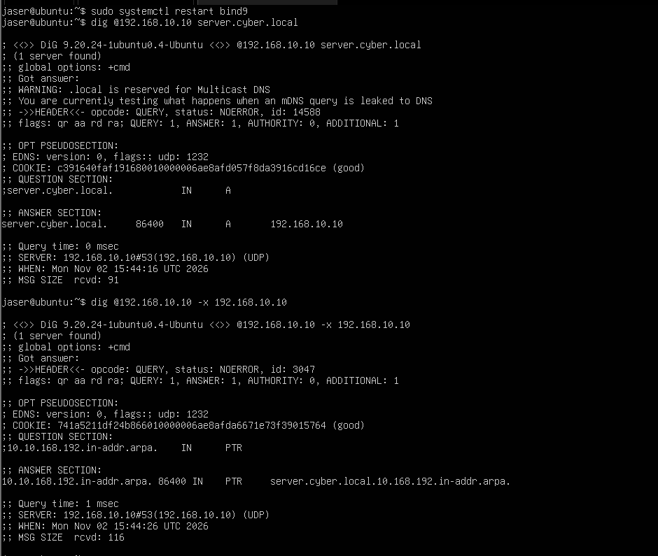

#### Query Validation Results:
- **Forward Query:** `server.cyber.local` resolved to `192.168.10.10` with status `NOERROR` and flags `qr aa rd ra` (Authoritative Answer).
- **Reverse Query:** `10.10.168.192.in-addr.arpa` resolved to the PTR record with status `NOERROR` and `0 msec` query latency.

---

### Section 5.0: ISC DHCP Server Configuration & Dynamic Pool Management

#### 5.1 Interface Binding (`/etc/default/isc-dhcp-server`)
The ISC DHCP daemon was bound to physical adapter `ens33`:

```text
INTERFACESv4="ens33"
INTERFACESv6=""
```

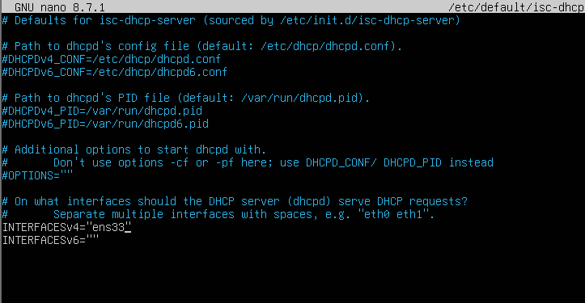

#### 5.2 Subnet Pool Declaration (`/etc/dhcp/dhcpd.conf`)
The dynamic address pool was defined for the `192.168.10.0/24` network segment, specifying dynamic lease boundaries and gateway options:

```text
subnet 192.168.10.0 netmask 255.255.255.0 {
    range 192.168.10.100 192.168.10.200;
    option routers 192.168.10.1;
    option subnet-mask 255.255.255.0;
    option broadcast-address 192.168.10.255;
    option domain-name-servers 192.168.10.10;
    option domain-name "cyber.local";
}
```

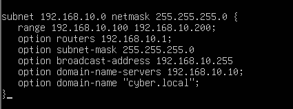

#### 5.3 Global Scopes & Authoritative Directive
Global network options, lease duration limits, and authoritative directives were configured:

```text
option domain-name "cyber.local";
option domain-name-servers 192.168.10.10;

default-lease-time 600;
max-lease-time 7200;
ddns-update-style none;
authoritative;
```

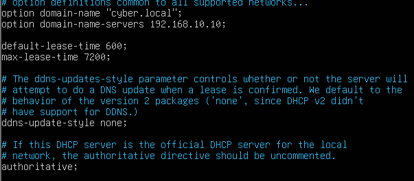

#### 5.4 Pre-flight Syntax Validation & Service Startup
Before service execution, the configuration was checked using `dhcpd -t`:

```bash
sudo dhcpd -t -cf /etc/dhcp/dhcpd.conf
sudo systemctl restart isc-dhcp-server
sudo systemctl enable isc-dhcp-server
sudo systemctl status isc-dhcp-server
```

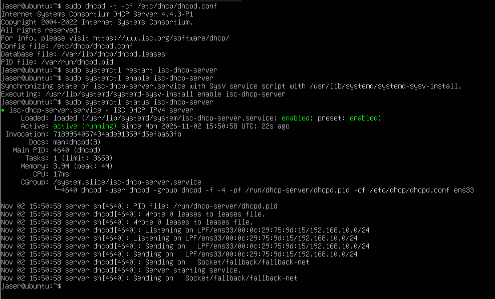

#### Daemon Operational Verification:
- Configuration parsing completed without syntax or semantic errors.
- Daemon `isc-dhcp-server.service` transitioned to `active (running)`.
- Confirmed socket listeners on `LPF/ens33/00:0c:29:75:9d:15/192.168.10.0/24`.

---

### Section 6.0: End-to-End Client Network Provisioning & Verification

To validate that the infrastructure operates seamlessly, an unconfigured client workstation (**Ubuntu Desktop**) connected to the `192.168.10.0/24` broadcast domain was monitored:

#### 6.1 Routing & DNS Resolver Verification on Client
From the client terminal (`jaser@jaser`), routing and systemd-resolved states were audited:

```bash
ip route
resolvectl status
```

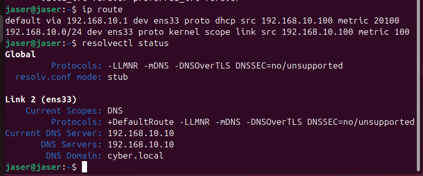

- **Default Route:** `default via 192.168.10.1 dev ens33 proto dhcp src 192.168.10.100 metric 20100`.
- **Active Scopes:** Interface `ens33` received DNS Server `192.168.10.10` and DNS Domain `cyber.local`.

#### 6.2 Client Dynamic Lease Verification
Audited dynamic IP assignment on client interface `ens33`:

```bash
ip a
```

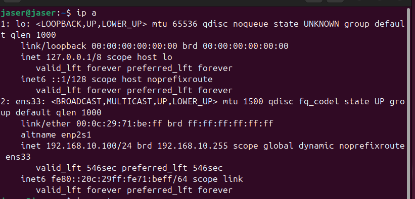

- **Dynamic IPv4 Address:** Client successfully acquired `192.168.10.100/24` (the first available IP in the configured pool `192.168.10.100` – `192.168.10.200`).
- **Lease Lifetime:** Active dynamic lease with `valid_lft 546sec` / `preferred_lft 546sec` matching the server's `default-lease-time 600`.

---

## 📊 Verification Matrix

| Infrastructure Component | Verification Target / Command | Expected Behavior | Production Status |
|---|---|---|:---:|
| **Package Provisioning** | `apt install isc-dhcp-server bind9` | Packages successfully committed to OS | **PASSED** |
| **User & Group RBAC** | `id net1; id sec1; id sup1` | Accounts bound to respective security groups | **PASSED** |
| **Directory Isolation** | `/company/{networks,cybersecurity,support}` | Group-restricted directory hierarchy | **PASSED** |
| **Static Netplan Config** | `ip a show ens33` | Static assignment `192.168.10.10/24` | **PASSED** |
| **System Hostname** | `hostname` | Returns localized identity `server` | **PASSED** |
| **Authoritative DNS Forward** | `dig @192.168.10.10 server.cyber.local` | Returns `192.168.10.10` with `NOERROR` | **PASSED** |
| **Authoritative DNS Reverse** | `dig @192.168.10.10 -x 192.168.10.10` | PTR record resolved successfully | **PASSED** |
| **DHCP Daemon Syntax** | `dhcpd -t -cf /etc/dhcp/dhcpd.conf` | Exit code `0` (Zero syntax errors) | **PASSED** |
| **DHCP Daemon Service** | `systemctl status isc-dhcp-server` | `active (running)` on `ens33` | **PASSED** |
| **Dynamic Client Lease** | Client `ip a show ens33` | Dynamically acquired `192.168.10.100/24` | **PASSED** |
| **Client Gateway Acquisition** | Client `ip route` | Default route assigned via `192.168.10.1` | **PASSED** |
| **Client DNS Search Domain** | Client `resolvectl status` | DNS Server `192.168.10.10`, Domain `cyber.local` | **PASSED** |

---

_Documented by **[Jaser Halabi](https://github.com/JaserHalabi)**_
